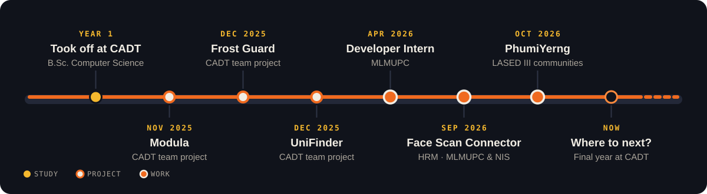
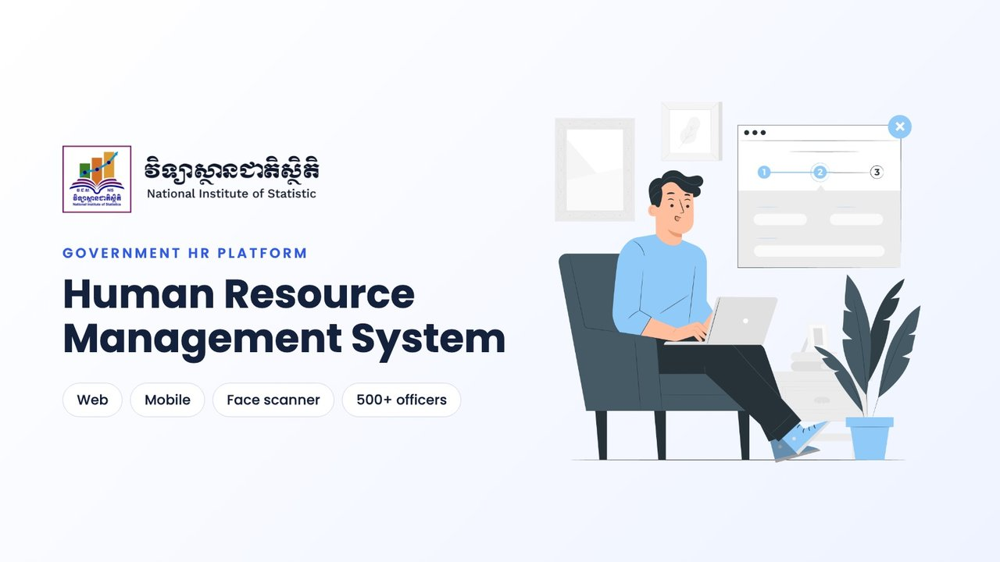
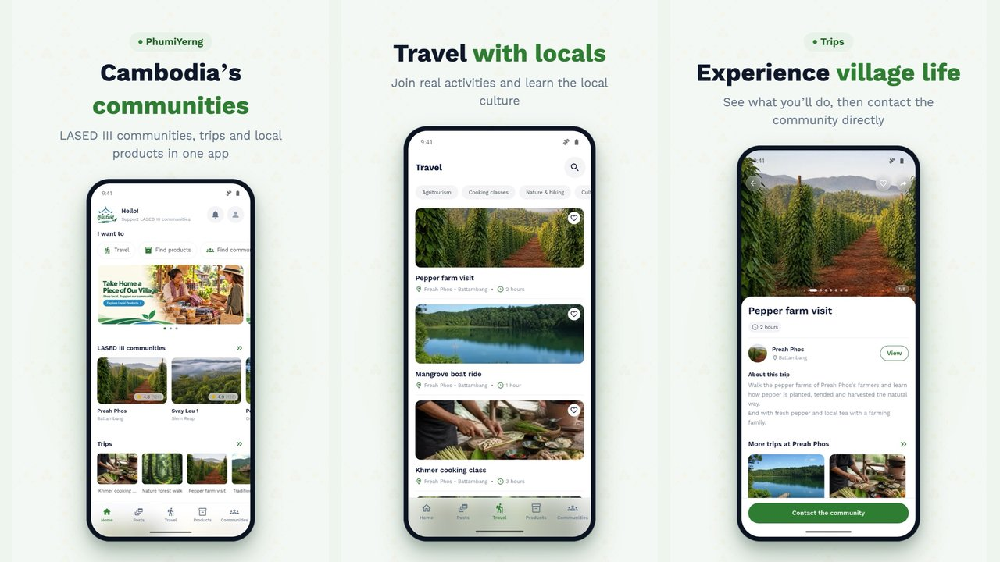
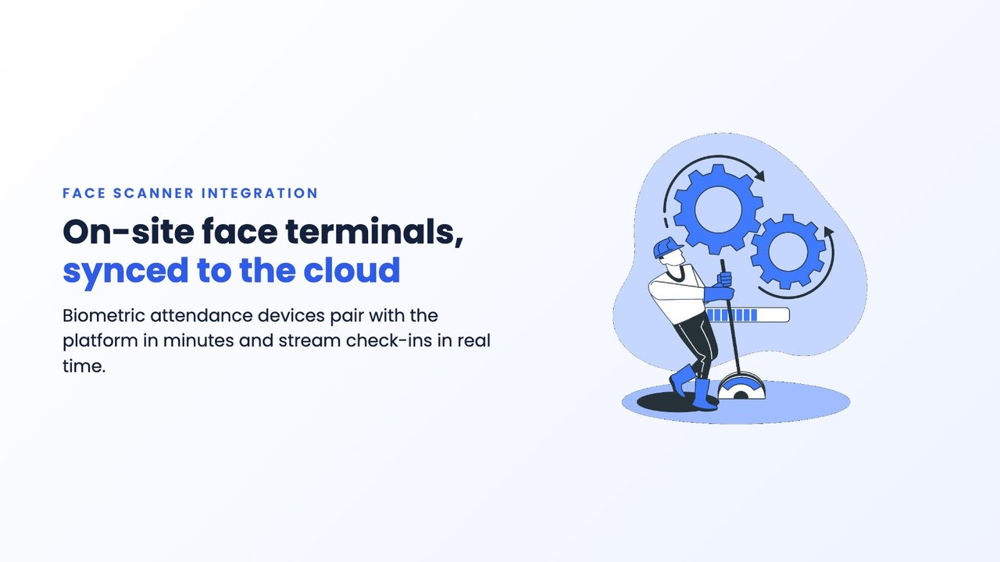
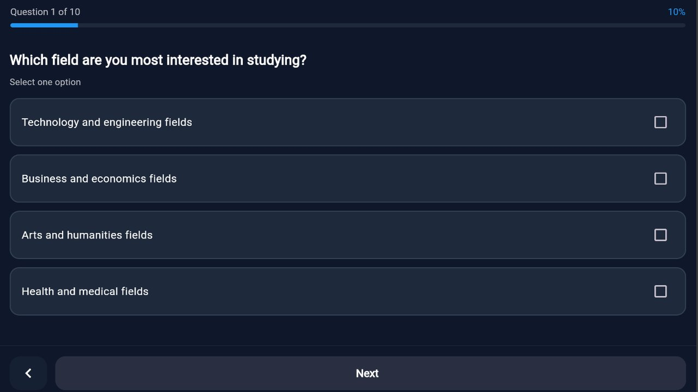
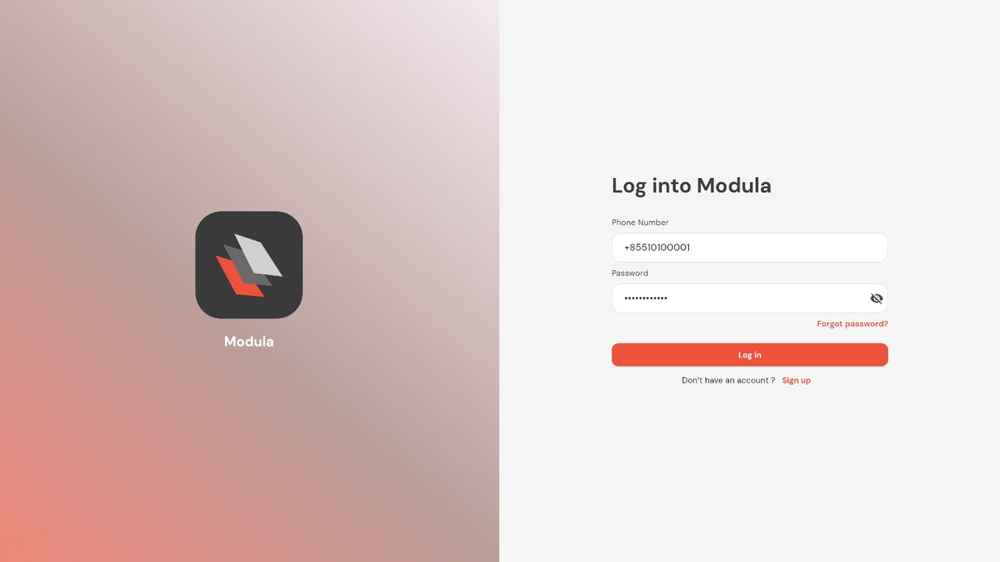
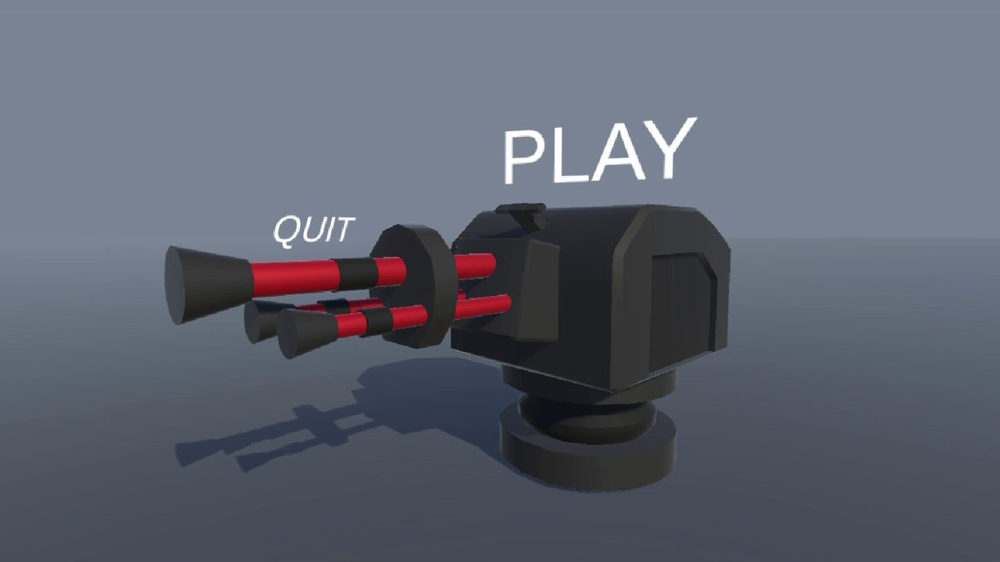

  

  
  

  I'm a fourth-year Computer Science student at the Cambodia Academy of Digital Technology. 
  During my three-month internship with the Digital Revolution team at MLMUPC. 
  I build cross-platform apps with Flutter, web apps with React and Angular, 
  and the NestJS and Express APIs behind them, and I love creating 
  useful apps that solve real-world problems.

  

<table>
  <tr><td align="center"><b>Languages</b></td><td align="center"></td></tr>
  <tr><td align="center"><b>Mobile & Frontend</b></td><td align="center"></td></tr>
  <tr><td align="center"><b>Backend & Data</b></td><td align="center"></td></tr>
  <tr><td align="center"><b>Cloud, Hardware & Tools</b></td><td align="center"></td></tr>
</table>

  
  

<table>
  <tr>
    <td align="center" width="50%"> <b>HRM System</b>: government HR platform for attendance, leave and officer records at MLMUPC and NIS Flutter · Angular · NestJS · PostgreSQL</td>
    <td align="center" width="50%"> <b>PhumiYerng</b>: marketplace and community-tourism app for rural LASED III communities Flutter · Dart · NestJS · Socket.IO</td>
  </tr>
  <tr>
    <td align="center"> <b>Face Scan Connector</b>: pairs Raspberry Pi face scanners with HRM so every scan becomes an attendance record Python · Raspberry Pi · NestJS · Angular</td>
    <td align="center"> <b>UniFinder</b>: offline app that helps rural students find their best-fit university majors Flutter · Dart · go_router</td>
  </tr>
  <tr>
    <td align="center"> <b>Modula</b>: modular point-of-sale system for small food & beverage businesses Flutter · Riverpod · Express · PostgreSQL</td>
    <td align="center"> <b>Frost Guard</b>: tower defense game set in an endless, magical winter Unity · C#</td>
  </tr>
</table>

<a href="https://cheyrotana-portfolio-v1.vercel.app">See all my projects →</a>

  
  
  

  

